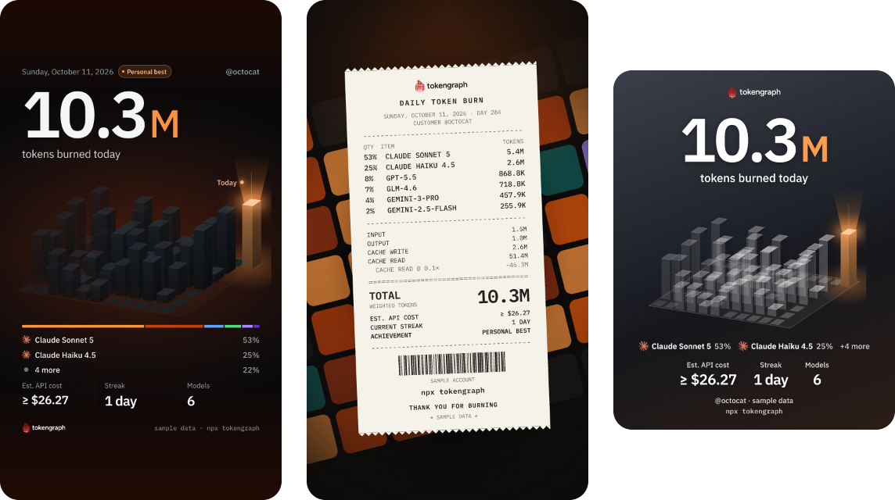

<p align="center">
  <picture>
    <source media="(prefers-color-scheme: dark)" srcset="docs/assets/logo-dark.svg">
    
  </picture>
</p>

<h3 align="center">Your AI coding, as a GitHub-style graph.</h3>

<p align="center">
  <em>Claude Code, Codex CLI, Cursor, Gemini CLI, Cline and OpenCode: one graph, in your README.<br>
  Your usage never leaves your machine unless you publish it, and then only to your own gist.</em>
</p>

<p align="center">
  <a href="https://www.npmjs.com/package/tokengraph"></a>
  <a href="https://github.com/altindalorcun/tokengraph/blob/main/LICENSE"></a>
  <a href="https://github.com/altindalorcun/tokengraph/actions/workflows/ci.yml"></a>
</p>

<p align="center">
  <picture>
    <source media="(prefers-color-scheme: dark)" srcset="docs/assets/graph-dark.svg">
    
  </picture>
</p>

## Quick start

```bash
npx tokengraph            # your graph, right in the terminal
npx tokengraph login      # publish it to your GitHub gist and get the README snippet
npx tokengraph story      # turn today into story cards and send them to your phone
```

Needs Node.js 22 or newer. To keep the README graph fresh without thinking about it:
`npm install -g tokengraph && tokengraph schedule`.

## Put it in your README

`tokengraph login` publishes your graph to a public gist on your GitHub account and copies this
snippet to your clipboard. Run `tokengraph readme` to print it again. Paste it into your profile
README (the `YOUR_LOGIN/YOUR_LOGIN` repository):

```html
<a href="https://github.com/altindalorcun/tokengraph">
  <picture>
    <source media="(prefers-color-scheme: dark)" srcset="https://gist.githubusercontent.com/YOUR_LOGIN/GIST_ID/raw/tokengraph-dark.svg">
    
  </picture>
</a>
```

The graph switches between light and dark with the reader's GitHub theme. Every sync updates the
same gist, so the snippet never changes. Use `tokengraph readme --compact` for a smaller graph
without labels, and `tokengraph readme --colors single` for one colour instead of one per model
family (`--colors model` switches back).

## Share your day

<p align="center">
  
</p>

`tokengraph story` draws three cards (a skyline, a receipt and a sticker) as PNG files sized for
Instagram and TikTok stories, then shows a QR code. Scan it with your phone on the same Wi-Fi and
save the cards straight to Photos. Nothing is uploaded anywhere: your computer serves the files to
your phone until you have saved the cards, or after 10 idle minutes. Pick a period with `--range today|7d|30d|1y`, and leave
the estimated cost off with `--no-cost`.

## How it works

```
agent logs on your machine ──► tokengraph ──► ~/.tokengraph ledger ──► your gists
(Claude Code, Codex, …)        dedups,         (totals only grow)       public: the SVG graph
                               weights                                  secret: daily counts per machine
```

tokengraph reads the usage counters the agents already write to disk. It never reads your prompts
or answers. Each day's number is a weighted token count:

```
weighted tokens = input + output + cache writes + 0.1 × cache reads
```

Cache reads cost a fraction of fresh input, so they count a tenth. Without that, one long session
re-reading a big cached context would drown a day of real work. It measures work, not a bill.

- **No double counting.** Agents write the same message to disk several times while streaming,
  and resumed or forked sessions copy earlier records. tokengraph dedups by each agent's own
  message or response id, and never counts usage that another adapter already counts.
- **Totals only grow.** Agents delete old transcripts. The ledger keeps the largest count it has
  ever seen for each day, so history survives, and a fresh smaller scan never lowers it.

## Privacy

| | |
| --- | --- |
| **What leaves your machine** | To a public gist on your account: the SVG graphs (daily token totals and the names of the model families they are coloured by) and a README with the embed snippet and a link. To a secret gist on your account: per-day, per-model token counts, a random machine id, a label such as `darwin-3f2a1c`, a hashed machine fingerprint, the CLI version and the time of the last update. Both only after `tokengraph login`, and only when tokengraph publishes (`sync`, a hook, the schedule, or `login`). `sync --local`, `view` and `story` never do. |
| **What never does** | Prompts, answers, code, file names, paths. Nothing is sent to any tokengraph server: there is none. |
| **How to remove it** | `tokengraph logout` forgets the login on this machine. Delete the two gists on [gist.github.com](https://gist.github.com) to remove what was published. |

A secret gist is unlisted, not private: anyone who has its URL can read it. It holds the fields
listed above and never a hostname. Until
you run `tokengraph login`, nothing is sent anywhere.

## Supported agents

| Agent | Where it reads | Notes |
| --- | --- | --- |
| Claude Code | `~/.claude/projects/**/*.jsonl` (or `$CLAUDE_CONFIG_DIR`) | Claude Code deletes old transcripts, so sync at least every few weeks. `tokengraph install-hook --agent claude-code` syncs when a session ends. |
| Codex CLI | `~/.codex/sessions` and `archived_sessions` (or `$CODEX_HOME`) | `tokengraph install-hook --agent codex` syncs after a turn, at most every 10 minutes. It never overwrites a `notify` setting that is not its own. |
| Cursor | `~/.tokengraph/cursor-events.jsonl`, written by Cursor's `stop` hook | Cursor keeps no usable token counts on disk, so run `tokengraph install-hook --agent cursor` once and restart Cursor. Usage counts from that moment on. |
| Gemini CLI | `~/.gemini/tmp/*/chats` (or `$GEMINI_CLI_HOME`) | Gemini CLI deletes sessions after 30 days by default, so sync at least monthly. It never records some side calls, so totals are a lower bound. |
| Cline | `saoudrizwan.claude-dev/tasks` in VS Code-family editors, and `~/.cline/data` | Requests Cline sends through the Claude Code provider are skipped, because the Claude Code adapter already counts them. |
| OpenCode | `~/.local/share/opencode/opencode*.db` and the older `storage/` folder | Reading the database needs Node 22.13 or newer. Records from before OpenCode 1.3.16 that cannot be read with certainty are skipped and reported. |

Gemini CLI, Cline and OpenCode need no hook: `tokengraph schedule` syncs them every hour. Aider is
not supported, because its local history rounds token counts.

## Commands

Every command takes `--help`. An unknown option is an error.

| Command | What it does |
| --- | --- |
| `tokengraph [view]` | Opens the live terminal view: year heatmap, models, agents, streaks. `--print` prints a static snapshot. The default command in a terminal. |
| `tokengraph login` | Connects GitHub, publishes your graph to your own gist, prints the README snippet. Uses your GitHub CLI login if you have one (`--gh`), or a one-time code you approve in the browser (`--device`, `--no-open`). Asks for gist access only. |
| `tokengraph logout` | Forgets the GitHub login on this machine. Local data and your gists stay. |
| `tokengraph sync` | Reads every agent's logs into the ledger and, when logged in, publishes. `--since <days>` sets how far back to read (default 90), `--local` never touches the network. |
| `tokengraph readme` | Prints the README snippet and copies it. `--compact`, `--colors model\|single`. |
| `tokengraph story` | Draws story cards, saves the PNGs (to `~/Downloads` unless `--out <dir>`) and offers to send them to your phone. `--template skyline\|receipt\|sticker\|all`, `--range today\|7d\|30d\|1y`, `--no-cost`, `--qr` / `--no-qr`, `--no-preview`, `--handle <name>`. |
| `tokengraph status` | Shows the GitHub account, the ledger, your machines, and which background syncs are installed and healthy. |
| `tokengraph install-hook --agent <claude-code\|cursor\|codex>` | Makes that agent start a background sync when it finishes. `--remove` uninstalls it, `--dry-run` shows what would change. |
| `tokengraph schedule` | Installs an hourly background sync: launchd on macOS, cron on Linux, Task Scheduler on Windows. `schedule --remove` turns it off. |

Hooks and the schedule store the path of the installed program, so install tokengraph globally
(`npm install -g tokengraph`) before using them; both refuse to run from an `npx` cache.

## Several machines

Each machine writes its own file, `machine-<id>.json`, to the secret data gist. When you sync, the
graph is built from this machine plus every other machine's file, summed per day and model, so a
laptop and a desktop show up as one graph. The same files are a backup: after a reinstall or a
wiped `~/.tokengraph`, `tokengraph login` recognises your machine, restores its history and counts
nothing twice.

## FAQ

**Why gists?** They are free, they belong to you, GitHub serves and caches the images, and there
is no server for anyone to run, trust or shut down. If tokengraph disappears tomorrow, your graph
keeps working.

**Is the cost real?** It is an estimate at public API list prices, from a dated price table. It is
not what you were billed, which depends on your plan. A model with no known price is left out of
the total and marked unpriced, never counted as $0, so the total can only be a lower bound.

**Why weighted tokens?** Raw totals are mostly cache reads, which are cheap and large. Counting
them at a tenth keeps the graph about work done. The formula is under [How it works](#how-it-works).

**Does it work offline?** Yes. `view`, `story`, `status` and `sync --local` never use the network.
Only publishing needs GitHub.

**How do I stop?** `tokengraph schedule --remove`, `tokengraph install-hook --agent <name> --remove`
for each hook you added, and `tokengraph logout`. Then `npm uninstall -g tokengraph`. Delete the two
gists to remove what was published, and `~/.tokengraph` to remove the rest.

**Windows?** Paths, hooks and the hourly Task Scheduler job are written for Windows, but tokengraph
is developed on macOS and Linux, so expect rough edges and please open an issue.

## Contributing

Bug reports and pull requests are welcome; see [CONTRIBUTING.md](https://github.com/altindalorcun/tokengraph/blob/main/CONTRIBUTING.md). New agents
arrive as adapter PRs. What tokengraph is for, and what it will not do, is in the
[product notes](https://github.com/altindalorcun/tokengraph/blob/main/docs/product.md).

---

If tokengraph made your profile better, a ⭐ helps other people find it.

## License

MIT, see [LICENSE](https://github.com/altindalorcun/tokengraph/blob/main/LICENSE). Bundled third-party components: see
[THIRD-PARTY-NOTICES.md](https://github.com/altindalorcun/tokengraph/blob/main/packages/cli/THIRD-PARTY-NOTICES.md).
